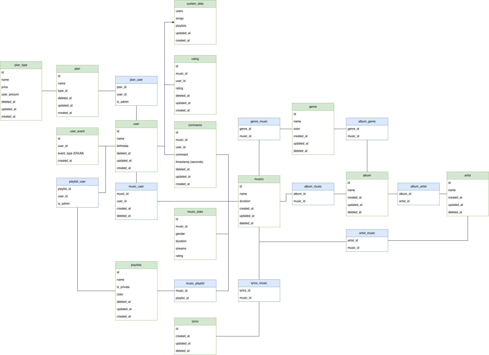

# Modelo Entidade-Relacionamento

O modelo de dados do Zovic. A fonte da verdade são as migrations em `db/migrations/`, e este documento acompanha a última delas (`V261105_151000__Adiciona_convites_do_plano.sql`).

## Diagrama

Os tipos são os do Postgres. `PK` marca a chave primária, `FK` a chave estrangeira e `UK` uma coluna única.

```mermaid
erDiagram
    plan_type ||--|{ plan : "classifica"
    plan ||--|{ plan_user : "possui"
    user ||--|{ plan_user : "assina"
    plan ||--o{ plan_invitation : "convida"

    user ||--o{ session : "abre"
    user ||--o{ account : "autentica por"
    user ||--o{ user_event : "gera"
    musics |o--o{ user_event : "tocada em"
    user ||--o{ playlist_user : "participa"
    playlists ||--|{ playlist_user : "tem membros"
    user ||--o{ music_user : "salva"
    musics ||--o{ music_user : "salva por"

    user ||--o{ rating : "avalia"
    musics ||--o{ rating : "recebe"
    user ||--o{ comments : "escreve"
    musics ||--o{ comments : "recebe"

    playlists ||--o{ music_playlist : "contém"
    musics ||--o{ music_playlist : "salva em"

    musics ||--o{ genre_music : "tem"
    genre ||--o{ genre_music : "classifica"
    genre ||--o{ album_genre : "classifica"
    album ||--o{ album_genre : "tem"

    musics ||--o{ album_music : "está em"
    album ||--o{ album_music : "lança"
    album ||--|{ album_artist : "de"
    artist ||--o{ album_artist : "lança"
    musics ||--|{ artist_music : "de"
    artist ||--o{ artist_music : "cria"

    plan_type {
        serial id PK
        varchar name
        numeric price
        int user_amount
        timestamptz deleted_at
        timestamptz created_at
    }
    plan {
        serial id PK
        varchar name
        int type_id FK
        timestamptz deleted_at
        timestamptz created_at
    }
    plan_user {
        int plan_id PK, FK
        int user_id PK, FK
        boolean is_admin
    }
    plan_invitation {
        serial id PK
        int plan_id FK
        varchar email "minúsculo"
        varchar token_hash UK "SHA-256 em hex"
        timestamptz expires_at
        timestamptz accepted_at
        timestamptz canceled_at
        timestamptz created_at
    }
    user {
        serial id PK
        varchar name
        date birthdate
        varchar email UK
        boolean email_verified
        text image
        varchar role "admin ou assinante"
        timestamptz deleted_at
        timestamptz created_at
        timestamptz updated_at
    }
    session {
        serial id PK
        int user_id FK
        text token UK
        timestamptz expires_at
        text ip_address
        text user_agent
        timestamptz created_at
        timestamptz updated_at
    }
    account {
        serial id PK
        int user_id FK
        text account_id
        text provider_id
        text password "hash"
        text access_token
        text refresh_token
        text id_token
        timestamptz access_token_expires_at
        timestamptz refresh_token_expires_at
        text scope
        timestamptz created_at
        timestamptz updated_at
    }
    verification {
        serial id PK
        text identifier
        text value
        timestamptz expires_at
        timestamptz created_at
        timestamptz updated_at
    }
    user_event {
        serial id PK
        int user_id FK
        user_event_type event_type
        int music_id FK
        timestamptz created_at
    }
    playlist_user {
        int playlist_id PK, FK
        int user_id PK, FK
        boolean is_admin
    }
    music_user {
        int music_id PK, FK
        int user_id PK, FK
        timestamptz created_at
        timestamptz deleted_at
    }
    system_data {
        boolean singleton PK "sempre true"
        int users
        int songs
        int playlists
        timestamptz created_at
    }
    rating {
        serial id PK
        int music_id FK
        int user_id FK
        smallint rating "1 a 5"
        timestamptz deleted_at
        timestamptz created_at
    }
    comments {
        serial id PK
        int music_id FK
        int user_id FK
        text comment
        int timestamp "segundos"
        timestamptz deleted_at
        timestamptz created_at
    }
    playlists {
        serial id PK
        varchar name
        boolean is_private
        char color "#RRGGBB"
        timestamptz deleted_at
        timestamptz created_at
    }
    music_playlist {
        int music_id PK, FK
        int playlist_id PK, FK
        int position
        timestamptz added_at
    }
    musics {
        serial id PK
        varchar name
        int duration "segundos"
        int lyrics_id
        int streams
        float rating
        timestamptz created_at
        timestamptz deleted_at
    }
    genre_music {
        int genre_id PK, FK
        int music_id PK, FK
    }
    genre {
        serial id PK
        varchar name
        char color "#RRGGBB"
        timestamptz created_at
        timestamptz deleted_at
    }
    album_genre {
        int genre_id PK, FK
        int album_id PK, FK
    }
    album {
        serial id PK
        varchar name
        timestamptz created_at
        timestamptz deleted_at
    }
    album_music {
        int album_id PK, FK
        int music_id PK, FK
    }
    album_artist {
        int album_id PK, FK
        int artist_id PK, FK
    }
    artist {
        serial id PK
        varchar name
        timestamptz created_at
        timestamptz deleted_at
    }
    artist_music {
        int artist_id PK, FK
        int music_id PK, FK
    }
```

## Tabelas

As colunas estão no diagrama. As tabelas abaixo dizem o que cada uma guarda e as regras do modelo. As regras de formato e de valor (CHECK e UNIQUE) são garantidas pelo banco. As de cardinalidade ("ao menos um") são garantidas pelas entidades do domínio, descritas em [Models](models.md).

### Planos e usuários

| Tabela | O que guarda | Regras |
| --- | --- | --- |
| `plan_type` | Os tipos de plano, com preço e limite de pessoas | `price >= 0` e `user_amount > 0`. O Individual tem limite 1 e o Família, 4. |
| `plan` | Um plano assinado | Todo plano é de um tipo. A assinatura ativa é um plano sem `deleted_at`. |
| `plan_user` | Quem está em cada plano e quem é o titular (`is_admin`): o assinante do individual ou o gestor do familiar | Todo plano tem ao menos uma pessoa. O limite do tipo é conferido pela API, que conta os membros e os convites pendentes. Uma conta nova não tem plano até assinar. Sair ou ser removido apaga a linha. |
| `plan_invitation` | Os convites do plano familiar: o email convidado, o hash do token e a validade | `email` sempre minúsculo e `token_hash` único. O banco guarda só o hash SHA-256 do token, então não guarda um link utilizável. Um convite está pendente enquanto `accepted_at` e `canceled_at` são nulos e `expires_at` está no futuro, e só vale com o plano ativo (`plan.deleted_at` nulo). Pendente, ele ocupa uma vaga. Apagar o plano apaga os convites. |
| `user` | Os usuários. É também a tabela de usuário do Better Auth. | `email` é único e sempre minúsculo. `role` é `admin` ou `assinante` (o padrão). O email de uma conta removida continua reservado. |
| `user_event` | Cadastros, logins, logouts e reproduções (`sign_up`, `login`, `logout`, `music_play` e `music_skip`) | `music_id` só pode ser preenchido em `music_play` e `music_skip`. É a base das estatísticas do painel de admin. |
| `system_data` | Os totais do sistema: usuários, músicas e playlists | Tem uma linha só: a chave `singleton` só aceita `true`, então um segundo `INSERT` falha. A migration já cria essa linha. |

### Interações com músicas

| Tabela | O que guarda | Regras |
| --- | --- | --- |
| `music_user` | As músicas salvas por cada usuário | |
| `rating` | As avaliações | Nota de 1 a 5. Cada usuário tem uma avaliação ativa por música. |
| `comments` | Os comentários | `timestamp` é o segundo da música a que o comentário se refere, opcional e `>= 0` |

### Playlists

| Tabela | O que guarda | Regras |
| --- | --- | --- |
| `playlists` | As playlists | `color` no formato `#RRGGBB`, opcional |
| `playlist_user` | Os membros de cada playlist e quem é admin | Toda playlist tem ao menos um membro |
| `music_playlist` | As músicas de cada playlist, com a posição e a data em que entraram | `position` é única em cada playlist e pode ter buracos. A unicidade só é conferida no `COMMIT`, para a reordenação trocar as posições num `UPDATE` só. |

### Catálogo

| Tabela | O que guarda | Regras |
| --- | --- | --- |
| `musics` | As músicas | `duration > 0`. `streams` e `rating` (a média das avaliações ativas) são estatísticas da própria música. |
| `genre` | Os gêneros | Nome único entre os gêneros ativos. `color` obrigatória, no formato `#RRGGBB`. |
| `album` | Os álbuns | |
| `artist` | Os artistas | |
| `artist_music` | Os artistas de cada música | Toda música tem ao menos um artista |
| `album_artist` | Os artistas de cada álbum | Todo álbum tem ao menos um artista |
| `album_music` | As faixas de cada álbum | |
| `genre_music` e `album_genre` | Os gêneros de cada música e de cada álbum | |

### Autenticação (Better Auth)

As tabelas vêm da migration `V261020_162546__Adota_Better_Auth.sql`. O Flyway é dono do schema, e o Better Auth só lê e grava. O mapeamento das colunas fica em `api/adapters/auth/create-auth.ts`.

| Tabela | O que guarda | Regras |
| --- | --- | --- |
| `session` | As sessões abertas | `token` é único e é o valor do cookie de sessão |
| `account` | Uma linha por forma de login. Com email e senha, `provider_id` é `credential` e o hash fica em `password`. | O par (`provider_id`, `account_id`) é único. Um login social seria outra linha, sem mudar o schema. |
| `verification` | Tokens de confirmação de email e de recuperação de senha | Ainda não é usada |

## Convenções

- **Soft delete:** as tabelas com `deleted_at` nunca apagam linhas. Uma linha removida tem `deleted_at` preenchido.
- **Datas:** as tabelas registram `created_at` e, quando aplicável, `deleted_at`. Só as tabelas do Better Auth têm `updated_at`, porque a biblioteca atualiza esses registros.
- **Tabelas associativas** (N:N) não têm `id`: a chave primária é o par de chaves estrangeiras.
- **Exclusão em cascata:** apagar de verdade um usuário, uma música, uma playlist, um álbum, um artista ou um gênero apaga os vínculos deles. Na prática, isso quase não acontece, porque a aplicação usa soft delete. Um tipo de plano em uso não pode ser apagado.
- **CHECKs ficam só no SQL.** O Prisma não os representa, então o `schema.prisma` não mostra essas regras.

## Pontos em aberto

- **Letras:** a coluna `musics.lyrics_id` existe, mas ainda não há tabela de letras.
