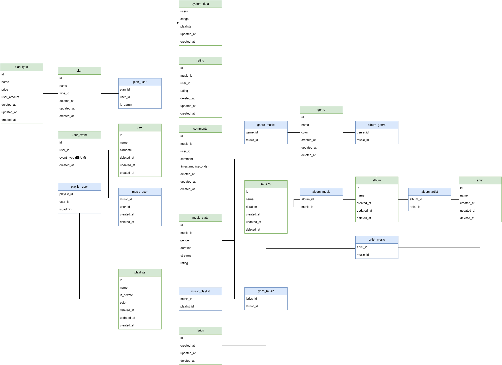

# Uso de IA no projeto

## Por que usamos IA

Usamos um assistente de IA (Claude Code) para acelerar tarefas repetitivas e mecânicas, como transcrever diagramas, escrever código de configuração e gerar o schema do banco. Assim, a equipe gasta o tempo nas decisões de modelagem e de produto.

A IA não decide nada sozinha:

- as decisões de modelagem são da equipe; a IA só transcreve e implementa o que foi definido;
- todo resultado é revisado por alguém da equipe antes de entrar no repositório;
- os prompts ficam registrados aqui, para deixar claro o que foi gerado com IA e a partir de quê.

## Registro de prompts

### 06/10/2026: modelo ER e banco de dados

Ponto de partida: o diagrama ER que a equipe fez no draw.io. A imagem abaixo é a versão atual (`Zovic2.drawio`); os prompts desta data partiram da primeira versão (`Zovic.drawio`).

| # | Prompt | Resultado |
|---|---|---|
| 1 | Consegue transformar essa relação de ER em um arquivo .md para colocar no repositório? *(com a imagem acima anexada)* | [`docs/modelo-er.md`](../modelo-er.md) |
| 2 | Atualize o md: `album_genre` tem `album_id`; trocamos `gender` por `genre`; `lyrics` não tem coluna de conteúdo (ex.: `text`), porque ainda não decidimos como armazenar essa informação; `system_data` não tem `id`; se for tabela de linha única, documente essa escolha. | Correções em [`docs/modelo-er.md`](../modelo-er.md) |

O conteúdo gerado não foi o resultado final, apenas um passo intermediário para a criação do banco de dados

### 13/10/2026: seeders do banco

| # | Prompt | Resultado |
|---|---|---|
| 1 | Escreva os seeders em `api/prisma/seed/`, com um arquivo por grupo: planos, usuários, catálogo, interações e playlists. O seed deve poder rodar várias vezes (limpa as tabelas e zera os IDs antes de inserir), gerar sempre os mesmos dados e se recusar a rodar se o `DATABASE_URL` não apontar para `localhost`. Respeite as regras do modelo: toda música e todo álbum com ao menos um artista; todo plano com ao menos um usuário, e todo usuário com ao menos um plano; toda playlist com ao menos um membro e um admin; notas de 1 a 5, com uma avaliação ativa por usuário e música; cores no formato `#RRGGBB`. `musics.rating` deve ser a média real das avaliações, e `system_data` deve terminar com os totais corretos. Os dados do catálogo são fictícios e escritos à mão. Planos e gêneros também vão para produção: deixe em um arquivo as opções `LOCAL`, `PROD` e `ALL` para definirmos onde cada seeder roda. | [`api/prisma/seed/`](../../api/prisma/seed/) |
| 2 | Escreva a documentação do banco de dados em `docs/banco-de-dados.md`: o papel do Flyway e do Prisma, o padrão de nome das migrations, como criar uma migration e atualizar o Prisma, como rodar o seed e como ver o banco. | [`docs/banco-de-dados.md`](../banco-de-dados.md) |
| 3 | Revise a documentação do projeto e atualize o que estiver desatualizado em relação ao que foi feito. | Ajustes no [`README.md`](../../README.md), em [`docs/README.md`](../README.md), [`docs/docker.md`](../docker.md), [`docs/modelo-er.md`](../modelo-er.md) e no `.env.example` |

Depois, a equipe revisou e ajustou os dados gerados: os tipos de plano e os preços (ficaram Individual e Família), a lista de gêneros e suas cores, e os planos de cada usuário.

### 20/10/2026: entidades do catálogo, documentação das models e testes

| # | Prompt                                                                                                                                                                                                               | Resultado |
|---|----------------------------------------------------------------------------------------------------------------------------------------------------------------------------------------------------------------------|---|
| 1 | Vamos começar um `models.md` para explicar como funcionam as models e todas as funções de cada model (tabela com o nome e a explicação).                                                                             | [`docs/models.md`](../models.md) |
| 2 | Configure para que todo push rode os testes antes, para conferir se eles estão quebrando, e mostre no terminal que os testes passaram.                                                                               | Hook [`.husky/pre-push`](../../.husky/pre-push), script `test` no `frontend/package.json` e seção "Testes" no [`README.md`](../../README.md) |
| 3 | Faltam testes de soft delete: só o Genre confere que `findById` não devolve registro apagado. Cubra também Music (`findById` e `findByIds`), Album e Artist com base no código que eu já fiz para as outras classes. | Novos testes em [`postgres-catalog-repositories.test.ts`](../../api/adapters/db/postgres-catalog-repositories.test.ts) |
| 4 | Crie um CI no GitHub Actions que rode os testes da api e do frontend em todo push e PR para a `main`, incluindo os testes de integração com Postgres e as migrations do Flyway. Aproveite e remova o que sobrou do GitBook. | Workflow [`.github/workflows/ci.yml`](../../.github/workflows/ci.yml) e remoção do `docs/SUMMARY.md` (o índice foi para o [`docs/README.md`](../README.md)) |

### 20/10/2026: frontend (landing, catálogo de playlists, login e busca)

| # | Prompt | Resultado |
|---|---|---|
| 1 | Na tela de uma playlist, tire o card de waveforms, os filtros, os chips de qualidade (FLAC, vinil 180g…), o "Zovic Curadoria" e o nome da cor. Mantenha só as informações objetivas (número de faixas e duração), use a cor da playlist como fundo em toda a largura da tela e troque o texto "STEREO" por um controle de volume. | [`frontend/src/app/playlist/[id]/page.tsx`](../../frontend/src/app/playlist/[id]/page.tsx) |
| 2 | O bento grid de playlists está ruim: use uma lib melhor. O tamanho deve ficar preso à posição do card, e não à playlist, e quero um botão que sorteie os tamanhos mantendo a ordem, sem deixar nenhum espaço vazio nas linhas. | Grid com `react-grid-layout` em [`frontend/src/app/playlist/page.tsx`](../../frontend/src/app/playlist/page.tsx) e [`frontend/src/lib/playlist-layout.ts`](../../frontend/src/lib/playlist-layout.ts) |
| 3 | Adicione uma opção de ver as playlists em lista, parecida com a lista de faixas, com um único botão que alterna entre grade e lista. Quero poder arrastar para reordenar tanto a lista de playlists quanto as faixas dentro de uma playlist, e clicar em qualquer ponto de uma faixa deve tocá-la. | [`frontend/src/components/sortable-list.tsx`](../../frontend/src/components/sortable-list.tsx) |
| 4 | Use a cor da playlist e variações dela como cor de destaque e de seleção de texto na tela da playlist, inclusive no fundo que aparece ao arrastar uma faixa. No resto do app, a seleção de texto e o foco devem usar o vermelho principal. | Variáveis de cor em [`frontend/src/app/playlist/[id]/page.tsx`](../../frontend/src/app/playlist/[id]/page.tsx) e [`frontend/src/app/globals.css`](../../frontend/src/app/globals.css) |
| 5 | Faça uma landing page com seções abaixo do hero (como funciona, chamada final e rodapé). Os links de seção do header e o botão "Ver como funciona" devem rolar até a seção sem deixar `#` na URL, para continuarem funcionando depois de voltar ao topo. | [`frontend/src/app/page.tsx`](../../frontend/src/app/page.tsx) e [`frontend/src/components/section-link.tsx`](../../frontend/src/components/section-link.tsx) |
| 6 | Coloque um glass leve no header, sem borda e com um pequeno feather embaixo. Quando o header passar sobre uma seção escura, o texto e a logo devem ficar claros. | Classe `glass` em [`frontend/src/app/globals.css`](../../frontend/src/app/globals.css) e [`frontend/src/components/header.tsx`](../../frontend/src/components/header.tsx) |
| 7 | Leia a issue #1 do repositório e planeje o fluxo de login no frontend. Como a API ainda não tem autenticação, implemente as telas de entrar e de cadastro com uma autenticação simulada no navegador, com a mesma API do cliente do BetterAuth, para trocar depois pela API real. Proteja as telas de playlist para quem não estiver logado. | [`frontend/src/lib/auth/`](../../frontend/src/lib/auth/), [`frontend/src/app/entrar/`](../../frontend/src/app/entrar/) e [`frontend/src/app/cadastro/`](../../frontend/src/app/cadastro/) |
| 8 | Nos formulários de login e cadastro, deixe o label no meio do campo, subindo com animação ao selecionar. Mostre cada erro embaixo do campo, com um indicador no próprio campo, e leve o foco automaticamente ao primeiro erro. | [`frontend/src/components/auth-form.tsx`](../../frontend/src/components/auth-form.tsx) |
| 9 | Troque a biblioteca de ícones por uma de ícones animados, de um jeito que dê para voltar aos ícones antigos se eu não gostar. | [`frontend/src/components/icons/`](../../frontend/src/components/icons/) (a troca é uma linha em `icons/index.ts`) |
| 10 | Implemente uma barra de pesquisa no centro do header, parecida com a do Spotify: ao digitar, ela sugere textos para completar, músicas, artistas e playlists. Mostre a barra só fora da landing page, e lá não mostre os links das seções. Mantenha modular, porque depois vamos criar a tela de resultados e as páginas de música e de artista. | [`frontend/src/lib/search/`](../../frontend/src/lib/search/) e [`frontend/src/components/search/`](../../frontend/src/components/search/) |
| 11 | Troque o indicador de conta do header por uma pílula com um ícone genérico de usuário; ao clicar, ela abre a opção de sair. | Menu de conta em [`frontend/src/components/header.tsx`](../../frontend/src/components/header.tsx) |
| 12 | Faça commits agrupando as principais mudanças desta sessão e abra um único PR. | Commits e PR desta entrega |

Durante a sessão, a equipe também pediu vários ajustes pequenos de visual (alinhamentos, tamanho do feather, cursores, remoção de cores e de rótulos), revisou cada mudança no navegador e voltou atrás em ideias que não funcionaram, como um tema escuro para o app inteiro.

### 03/11/2026: admin da plataforma e painel de admin

| # | Prompt                                                                                                                                                                                                                                                                                                                                                                                                                                         | Resultado |
|---|------------------------------------------------------------------------------------------------------------------------------------------------------------------------------------------------------------------------------------------------------------------------------------------------------------------------------------------------------------------------------------------------------------------------------------------------|---|
| 1 | Hoje há admins de contas (planos) e de playlists, mas não admins da plataforma como um todo. Confira isso no código e veja se a minha proposta de criar uma tabela de roles e uma pivot é a mais eficaz.                                                                                                                                                                                                                                       | Proposta: papel global em `user.role`, middleware de autorização e script para promover o primeiro admin |
| 2 | Me ajude a implementar um comando para promover um usuário pelo terminal.                                                                                                                                                                                                                                                                                                                                                                      | Script `bun run admin:promote <email> [--revoke]` em [`api/scripts/admin-promote.ts`](../../api/scripts/admin-promote.ts), que não retira o último admin |
| 3 | Tire o segundo "Zovic", aumente o título "Painel de admin", acabe com o scroll sem sentido na barra de abas e tire a borda dos cartões de dados. Depois, remova a linha que atravessa a página embaixo das abas e coloque labels nos gêneros da aba Conteúdo.                                                                                                                                                                                  | Ajustes em [`frontend/src/app/admin/`](../../frontend/src/app/admin/) e [`frontend/src/components/admin/`](../../frontend/src/components/admin/) |
| 4 | Me ajude com os conflitos ao mergear a `main` na minha branch.                                                                                                                                                                                                                                                                                                                                                                                 | Conflitos em [`routes.ts`](../../api/adapters/http/routes.ts) e [`composition-root.ts`](../../api/infra/composition-root.ts) resolvidos mantendo os dois lados; a migration de reproduções foi renomeada para depois da migration da `main`, para o Flyway não recusar uma versão fora de ordem |

O primeiro desenho do papel de admin foi revertido porque a `main` já tinha uma versão parecida; o trabalho seguiu sobre a versão da `main`. A equipe testou o cadastro e o painel no navegador, pediu os ajustes de visual da linha 6 depois de ver as telas e decidiu manter o registro de reproduções na API mesmo com o player do frontend ainda simulado.

### 03/11/2026: rotas de playlist e busca

| # | Prompt | Resultado |
|---|---|---|
| 1 | Separe as requisições de playlist no Bruno por escopo, para facilitar a visualização. | Subpastas em [`api/bruno/playlists/`](../../api/bruno/playlists/) |
| 2 | Como implementar no back a busca do header, no estilo do Spotify, que mostra playlists, músicas e artistas que correspondem ao termo? Isso é uma rota de listagem? E ela só acha o que o usuário já ouviu? | Explicação do desenho da rota, sem código: consulta que cruza recursos, no catálogo inteiro, e não listagem |
| 3 | Verifique o estado do repositório e atualize as documentações. | Seção "Rotas da API" no [`README.md`](../../README.md), [`docs/models.md`](../models.md), [`docs/banco-de-dados.md`](../banco-de-dados.md) e este registro |

A equipe revisou o desenho da busca antes da implementação e fez os merges dos dois PRs.

### 26/10 a 04/11/2026: servidor de produção

| # | Prompt | Resultado |
|---|---|---|
| 1 | Preciso fazer o setup do servidor do projeto no meu desktop: leia a seção de setup do mapa de implementação e me dê o passo a passo. | Roteiro guiado: WSL2 e Docker Desktop, repositório em `~/zovic`, domínio `zovic.com.br` na Cloudflare, túnel `zovic-desktop` e `.env` de produção |
| 2 | Implemente as mudanças no compose para o servidor de produção. | Profile `prod`, healthcheck da API, porta em `127.0.0.1` e serviço `cloudflared` numa rede só com a API, em [`docker-compose.yml`](../../docker-compose.yml) (PR #57) |
| 3 | Escreva um script simples, como o `bun start`, para subir e derrubar o servidor quando eu quiser. | [`scripts/server.ts`](../../scripts/server.ts) (`bun server`), que recusa subir sem o `.env` de produção (PR #60) |
| 4 | Deixe o servidor funcional para usuários autenticados e admins, diga o hardware reservado para cada container e crie perfis para os outros integrantes consultarem o banco de produção. | Limites de CPU, memória e processos no compose e [`api/scripts/db-member.ts`](../../api/scripts/db-member.ts) (`bun db:member`), com um usuário do Postgres por integrante atrás do Cloudflare Access (PR #74) |
| 5 | Crie um script para facilitar o login na Cloudflare e o acesso ao banco, e coloque-o no menu do `bun start`. | [`scripts/db-connect.ts`](../../scripts/db-connect.ts) (`bun db:connect` e a opção "banco de produção" do `bun start`) (PR #108) |
| 6 | Quero acessar o front pelo meu domínio, servido pelo próprio servidor. | Serviço `web` no profile `prod`, com a URL da API no build e uma rede só com o `cloudflared` (PR #109) |
| 7 | Atualize as documentações e o README para a equipe ter onde recorrer em caso de dúvidas. | [`docs/servidor.md`](../servidor.md) e os links no [`README.md`](../../README.md), em [`docs/docker.md`](../docker.md) e em [`docs/banco-de-dados.md`](../banco-de-dados.md) |

A configuração da Cloudflare (domínio, túnel, rotas, Access e redirecionamento do `www`) foi feita no painel, com a IA guiando cada tela. Cada mudança de código foi testada num ambiente descartável do Docker antes do PR, e o servidor foi conferido de fora: a API, o site e o banco atrás do Access. A equipe escolheu servir o front pelo desktop, e não pela Vercel, para front e API ficarem sempre na mesma versão.

### 04/11/2026: reorganização da documentação

| # | Prompt | Resultado |
|---|---|---|
| 1 | Sinto que as documentações do projeto estão muito verbosas e confusas. Gostaria de algo mais direto, mas explicativo, para a equipe, com os comandos que devemos rodar para tudo funcionar e o que cada um faz. | [`README.md`](../../README.md) reescrito como guia de comandos e [`docs/api.md`](../api.md) com o login, as variáveis e as rotas que estavam no README |
| 2 | Veja se dá para melhorar as outras documentações também. | Resumo dos comandos em [`docs/banco-de-dados.md`](../banco-de-dados.md), tipos reais e a coluna `role` no [`docs/modelo-er.md`](../modelo-er.md), as portas de consulta em [`docs/models.md`](../models.md), o environment `prod` do Bruno em [`docs/servidor.md`](../servidor.md) e o índice em [`docs/README.md`](../README.md) |

A IA conferiu os comandos, os caminhos e as constraints citados contra o código e as migrations antes de escrever.

### 05/11/2026: assinatura individual pela API

| # | Prompt | Resultado |
|---|---|---|
| 1 | Tenho algumas mudanças não commitadas e gostaria de terminar essa issue. Acha necessário fazer um plano? Perceba que ainda não tenho um banco de dados povoado. | Levantamento do que faltava na issue #85 e plano de implementação. O seed já existente resolveu o banco local |
| 2 | Decisões da equipe sobre o plano: desativar o plano Família até a #86 e exigir a assinatura também na API. | Middleware [`require-subscription.ts`](../../api/adapters/http/middlewares/require-subscription.ts) nas rotas de playlists, busca e catálogo, e cliente [`subscriptions.ts`](../../frontend/src/lib/api/subscriptions.ts) no lugar do `localStorage` |

A equipe escolheu o escopo e as duas decisões acima antes da implementação.

### 05/11/2026: plano familiar (#86, HU-04 a HU-07)

Forma de trabalho: o Claude Opus fez o plano, preparou a tarefa de cada fase, leu o diff, rodou as verificações e conduziu os testes no navegador. A implementação ficou com subagentes Claude Sonnet, um por fase, em sequência na mesma branch, sem commitar. Cada subagente começou sem contexto e recebeu o plano, as seções do `CLAUDE.md` e os critérios de aceite da fase.

| # | Prompt (resumo) | Resultado |
|---|---|---|
| 1 | Planejar a #86 a partir da issue e do código da #85: decisões de desenho (token de 32 bytes com só o hash no banco, vagas contando convites pendentes, trava por plano contra convites simultâneos, cadastro pelo convite com `invitationToken`) e as quatro fases | Plano da issue, aprovado pelo Gabriel (responsável pela issue) antes da implementação |
| 2 | Fase 1, banco e domínio: migração de `plan_invitation` e do limite de 4 no Família, ajuste do seed (Elisa em plano próprio, Gabriela na Família Costa), casos de uso de convidar, cancelar, consultar, aceitar, remover e sair, com testes unitários | [`V261105_151000__Adiciona_convites_do_plano.sql`](../../db/migrations/V261105_151000__Adiciona_convites_do_plano.sql), casos de uso em [`api/domain/use-cases/`](../../api/domain/use-cases/) |
| 3 | Fase 2, HTTP e cadastro: rotas de plano e de convite, `invitationToken` no cadastro, recusa de menor sem convite, testes de integração, `openapi.ts` e requisições do Bruno | [`subscription-controller.ts`](../../api/adapters/http/subscription-controller.ts), [`create-auth.ts`](../../api/adapters/auth/create-auth.ts) e [`api/bruno/assinaturas/`](../../api/bruno/assinaturas/) |
| 4 | Fase 3, front: assinar o Família, "Meu plano" do gestor e do membro, tela `/convite/[token]`, cadastro e entrada com convite, mensagens de erro | [`subscriptions.ts`](../../frontend/src/lib/api/subscriptions.ts), [`frontend/src/components/plan/`](../../frontend/src/components/plan/) e [`frontend/src/app/convite/`](../../frontend/src/app/convite/) |
| 5 | Fase 4, documentação: rotas, tabela `plan_invitation`, demo do README, hooks do cliente da API e este registro | [`docs/api.md`](../api.md), [`docs/modelo-er.md`](../modelo-er.md), [`README.md`](../../README.md) e [`frontend/src/lib/api/README.md`](../../frontend/src/lib/api/README.md) |

A revisão do Opus e os testes no navegador pegaram quatro erros, que voltaram aos subagentes para correção:

- uma conta removida pela plataforma continuava ocupando vaga no plano;
- a tela mostrava "convite inválido" logo depois de aceitar, porque a consulta do link, já usado, era refeita e respondia 404;
- o token do convite se perdia no caminho Entrar, depois Criar conta;
- um teste de integração novo dependia de uma música do seed LOCAL e quebraria no banco do CI, o que apareceu ao rodar a suíte num banco temporário só com migrações e seed de produção.

No fim, a coleção do Bruno passou 29/29 contra a API real, e o fluxo no navegador passou 34/34 checagens.

A diagramação do `docs/assets/modelo-er.png` não foi refeita: a imagem atual vem do draw.io, e a saída do mermaid ficou menos legível.

### 05/11/2026: histórico de reprodução (#96, HU-24)

Forma de trabalho: a mesma da #86. O Claude Opus fez o plano, preparou a tarefa de cada fase, leu o diff, rodou as verificações, um banco novo como o do CI, a coleção do Bruno e um teste no navegador com Playwright. A implementação ficou com subagentes Claude Sonnet, um por fase (API, front e documentação), em sequência na mesma branch, sem commitar.

| # | Prompt (resumo) | Resultado |
|---|---|---|
| 1 | Planejar a #96 a partir da issue: lista com cada música uma vez e a última reprodução, música removida pelo admin mantida como indisponível, e o que fica fora (filtro de conteúdo explícito para menores, que depende da coluna da #88, e a aba "Já ouvidas" da #91) | Plano da issue, aprovado pelo Gabriel (responsável pela issue) antes da implementação |
| 2 | Fase 1, API: porta e caso de uso do histórico, consulta no Postgres, rota `GET /api/history`, testes unitários e de integração, `openapi.ts` e requisições do Bruno | [`list-my-history.ts`](../../api/domain/use-cases/list-my-history.ts), [`postgres-play-history.ts`](../../api/adapters/db/postgres-play-history.ts) e [`api/bruno/historico/`](../../api/bruno/historico/) |
| 3 | Fase 2, front: página `/historico`, item "Histórico" no menu do usuário, estado vazio, música indisponível sem botão de tocar e lista atualizada a cada reprodução registrada | [`frontend/src/app/historico/`](../../frontend/src/app/historico/), [`history.ts`](../../frontend/src/lib/api/history.ts) e [`header.tsx`](../../frontend/src/components/header.tsx) |
| 4 | Fase 3, documentação: tabela de rotas, demo do README, cliente da API no front e este registro | [`docs/api.md`](../api.md), [`README.md`](../../README.md) e [`frontend/src/lib/api/README.md`](../../frontend/src/lib/api/README.md) |

### 05/11/2026: planos na landing (#84, HU-01)

O Claude Opus leu a #84, viu que o único critério sem código era a seção de planos na landing e a escreveu direto, sem subagentes. Os critérios da HU-02 já tinham testes de integração em `auth-flow.test.ts`, e todos foram conferidos no navegador com Playwright (13/13).

| # | Prompt (resumo) | Resultado |
|---|---|---|
| 1 | Fechar a #84 "até onde dá": seção de planos na landing com preço e número de pessoas, e conferir os critérios de cadastro e entrada | [`plans.tsx`](../../frontend/src/components/plans.tsx), com os planos, o preço formatado e o número de pessoas em [`rules.ts`](../../frontend/src/lib/subscription/rules.ts), usados também por `/planos` e `/meu-plano` |

### 05/11/2026: cadastro de música com áudio pelo painel de admin (HU-28)

| # | Prompt | Resultado |
|---|---|---|
| 1 | Ok, agora precisamos da rota de adição de músicas e que ela seja vinculada, primeiramente, ao portal admin. | Conversa de design: upload do áudio com os campos da HU-28, migração do áudio, do explícito e do ano do álbum nesta entrega, álbum opcional, só MP3 de até 20 MB e envio em multipart com o `multer`. Resultado: a [spec](../superpowers/specs/2026-11-05-cadastro-de-musica-com-audio-design.md) |
| 2 | Ok agora vamos aplicar a rota de cadastro de música e tudo mais. | O [plano de implementação](../superpowers/plans/2026-11-05-cadastro-de-musica-com-audio.md), em 9 tarefas com os testes antes do código |
| 3 | Vamos usar Native. Manda bala. | A implementação: a regra do MP3 ([`audio.ts`](../../api/domain/shared/audio.ts)), a migration, `Music` e `Album`, o armazenamento ([`local-file-storage.ts`](../../api/adapters/storage/local-file-storage.ts)), o caso de uso, as rotas com multipart, o cliente do front e a tela Conteúdo, com testes de unidade e de integração, o `openapi.ts`, o Bruno ([`api/bruno/admin/`](../../api/bruno/admin/)) e a documentação |
| 4 | Na tela de adição de músicas é preciso ter um campo para adicionar um artista novo; a duração deve ser identificada a partir do arquivo enviado; é preciso um campo de adição de gênero; a listagem de álbuns está muito feia. | A rota `POST /api/admin/genres`, o `musicCount` na `GET /api/albums`, a leitura da duração no navegador ([`audio-duration.ts`](../../frontend/src/lib/audio-duration.ts)), a criação de artista e gênero pelo formulário e os álbuns em cards ([`album-cover.ts`](../../frontend/src/lib/album-cover.ts)) |
| 5 | Precisamos mudar o campo de álbum: listar apenas os álbuns do artista selecionado e poder criar um novo, com nome e imagem de capa. Além disso, o campo de álbum deve ser mais bonito. | A capa obrigatória do álbum (migration, [`cover-image.ts`](../../api/domain/shared/cover-image.ts), o `LocalFileStorage` para áudios e capas, `PUT /api/admin/albums/:id/cover` e `GET /api/albums/:id/cover`) e a grade de capas no formulário de música ([`album-picker.tsx`](../../frontend/src/app/admin/conteudo/album-picker.tsx)) |

A equipe decidiu o escopo, o álbum opcional, o formato e o tamanho do arquivo e o uso do `multer`, aprovou a spec e o plano antes da implementação, e o time aprovou a dependência nova. A IA conferiu cada passo com os testes, rodou as requisições do Bruno contra a API e o cadastro pelo Docker, com o arquivo no volume `audio`. A tela do painel ainda precisa ser conferida no navegador.

### 06/11/2026: reprodução com áudio real e fila (#90, HU-13 e HU-14)

| # | Prompt | Resultado |
|---|---|---|
| 1 | Leia a passagem da sessão anterior e vamos implementar a reprodução das músicas (HU-13 e HU-14, issue #90). | Conversa de design: a música explícita para menor recusada na rota de áudio, a indisponibilidade descoberta pelo erro do `<audio>`, a audição contada quando o som começa, a fila como cópia da playlist e os botões da fila. Resultado: a [spec](../superpowers/specs/2026-11-06-reproducao-design.md) |
| 2 | Perfeito, continue. | O [plano de implementação](../superpowers/plans/2026-11-06-reproducao.md), em 8 tarefas com os testes antes do código |
| 3 | Manda bala. | A rota `GET /api/musics/:id/audio` ([`get-music-audio.ts`](../../api/domain/use-cases/get-music-audio.ts)) com testes de integração, o `openapi.ts` e o Bruno; a fila em [`playback-store.ts`](../../frontend/src/lib/playback-store.ts); o motor [`playback-audio.tsx`](../../frontend/src/components/playback-audio.tsx) com [`audio-player.ts`](../../frontend/src/lib/audio-player.ts); a barra, o player e o botão [`add-to-queue-button.tsx`](../../frontend/src/components/add-to-queue-button.tsx) |

A equipe decidiu cada regra na conversa de design e aprovou a spec e o plano antes da implementação. A IA conferiu cada passo com os testes, rodou a coleção do Bruno contra a API no Docker e deixou a conferência do som no navegador para o Victor.

### 05/11/2026: diagrama ER gerado do banco

Forma de trabalho: o Claude Opus testou três geradores de diagrama a partir do banco (tbls, SchemaSpy e D2 com o layout ELK) e comparou as imagens. O usuário escolheu o D2. Um subagente Claude Sonnet implementou o script a partir do protótipo aprovado.

| # | Prompt (resumo) | Resultado |
|---|---|---|
| 1 | Gerar o diagrama ER a partir do banco, com tabelas agrupadas por área, PK, FK e pé de galinha, sem alterar a imagem feita à mão | Protótipo com tbls e D2, aprovado pelo usuário |
| 2 | Implementar o `db:erd`: ler o Postgres com o `pg`, escrever o `.d2` e desenhar o `.svg` com o D2 em Docker, de forma determinística | [`api/scripts/db-erd.ts`](../../api/scripts/db-erd.ts), [`modelo-er-gerado.d2`](../assets/modelo-er-gerado.d2) e [`modelo-er-gerado.svg`](../assets/modelo-er-gerado.svg) |

### 06/11/2026: tela inicial e páginas de gênero e álbum (HU-33)

| # | Prompt | Resultado |
|---|---|---|
| 1 | Precisamos de uma landing page para o usuário depois do login: hoje é a tela de playlists, o que é ruim, já que um usuário novo não tem playlists nem nada do tipo. | Conversa de design: as seções (mais tocadas, ouvidas recentemente, playlists, novidades e gêneros), o endereço `/inicio`, o layout editorial e as páginas de gênero e de álbum, só no front. Resultado: a [spec](../superpowers/specs/2026-11-06-tela-inicial-design.md) |
| 2 | Pode seguir, mas a miniatura da música no player deve ser a capa do álbum da música, assim como nas cartas. | A capa do álbum na barra e no `/player` entrou na spec e no [plano de implementação](../superpowers/plans/2026-11-06-tela-inicial.md), em 7 tarefas com os testes antes do código |
| 3 | Manda bala. | As regras de seleção em [`home.ts`](../../frontend/src/lib/home.ts) e a capa da faixa em [`track-cover.ts`](../../frontend/src/lib/track-cover.ts), com testes; as páginas [`inicio/`](../../frontend/src/app/inicio/), [`genero/`](../../frontend/src/app/genero/) e [`album/`](../../frontend/src/app/album/); o redirecionamento depois do login e a capa na [barra](../../frontend/src/components/playback-bar.tsx) e no [player](../../frontend/src/app/player/page.tsx) |
| 4 | Precisamos de uma barra de opções para ser possível navegar entre as páginas importantes do site (com a busca mantida como está hoje). | A navegação principal no cabeçalho, em [`main-nav.tsx`](../../frontend/src/components/main-nav.tsx): Início, Playlists, Histórico e Tocando. Ela mostra ícones a partir de 1024 px, porque os nomes não cabem ao lado da busca centralizada, e fica no menu ☰ em telas menores. O destaque da página atual tem teste em [`main-nav.ts`](../../frontend/src/lib/main-nav.ts) |

A equipe escolheu as seções, o layout e o que fica com o Carlos (a página de artista e o número da faixa), e aprovou a spec e o plano antes da implementação. A IA conferiu cada tela por capturas do Chrome, com uma conta nova e com a do seed, e deixou a conferência no Opera para o Victor.

### 07/11/2026: logo e identidade visual no front

| # | Prompt | Resultado |
|---|---|---|
| 1 | Me mande a paleta de cores do site. | A lista das cores de [`globals.css`](../../frontend/src/app/globals.css), com o uso de cada uma |
| 2 | Criei esse logo, qual a sua sugestão para adaptar a paleta? Não, eu quero é adaptar o meu logo. Me mande como se fosse um prompt as sugestões que você tem. *(com a primeira versão do logo anexada)* | Um prompt para o gerador de imagem, com as cores do site: vermelho `#d33a2c`, preto `#171512`, papel `#efe7d8`, creme `#f8f3e7` e o verde-azulado `#1e7f82` nos olhos do gato. Com ele, o Felipe gerou as imagens de [`docs/images/`](../images/) |
| 3 | Me ajude a incorporar as novas imagens no front do site. *(e, na conversa: o gato sobre um dos discos da estante do login, sobre a prévia da playlist "MPB dos Anos Dourados" na landing e, depois do login, só no header)* | O componente [`zovic-cat.tsx`](../../frontend/src/components/zovic-cat.tsx), o gato no [`hero-preview.tsx`](../../frontend/src/components/hero-preview.tsx) e no [`auth-form.tsx`](../../frontend/src/components/auth-form.tsx), o favicon `frontend/src/app/icon.png` e o título "Zovic" da aba |
| 4 | Atualize o header do site com `docs/images/Zovic_header.png`. | O logo com o nome no [`header.tsx`](../../frontend/src/components/header.tsx), sem o fundo bege, em duas versões: letras pretas e, sobre as seções escuras da landing, letras claras (`frontend/public/zovic-header.png` e `zovic-header-dark.png`) |

O Felipe criou o logo e escolheu onde cada imagem aparece. A IA só tirou o fundo das imagens e as encaixou nas telas, e conferiu a landing e o login no navegador.

### 12/11/2026: página do artista (#88, HU-10)

| # | Prompt | Resultado |
|---|---|---|
| 1 | https://github.com/Warphn/Zovic/issues/88 Faça um plano local de implementação para essa task. | Plano em três PRs: o número da faixa, a página do artista e a ficha da música, com as dependências das curtidas (#94) e do filtro de menores (#87) |
| 2 | Pode começar. | A seleção em [`home.ts`](../../frontend/src/lib/home.ts) (`albumsOfArtist` e `singlesOfArtist`), com testes; a página [`artista/`](../../frontend/src/app/artista/); o card de álbum em [`album-card.tsx`](../../frontend/src/components/album-card.tsx), compartilhado com o `/inicio`; os links no cabeçalho do álbum e nas sugestões de artista da busca ([`routes.ts`](../../frontend/src/lib/search/routes.ts)); e o teste de integração do artista removido |

O Carlos aprovou o plano e cada PR antes de abrir. A IA conferiu a página no navegador do Claude Code, com a conta do seed.

### 12/11/2026: álbuns na busca (#89, HU-12)

| # | Prompt | Resultado |
|---|---|---|
| 1 | Implemente essa issue: https://github.com/Warphn/Zovic/issues/89 | O grupo de álbuns em [`postgres-search-query.ts`](../../api/adapters/db/postgres-search-query.ts), achados pelo nome e com ano, capa e artistas; as músicas explícitas fora da busca de um menor, também nas contagens (regra da HU-09, decidida no caso de uso [`search-catalog.ts`](../../api/domain/use-cases/search-catalog.ts)); os álbuns na barra de busca e na página [`busca/`](../../frontend/src/app/busca/page.tsx), levando à página do álbum; testes de unidade e de integração e a requisição `busca/Buscar álbum` do Bruno |

O Carlos revisou o PR antes de abrir. A IA conferiu a busca no navegador do Claude Code, com a conta do seed.
